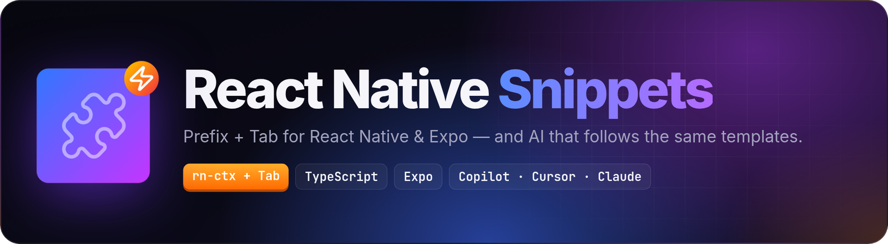
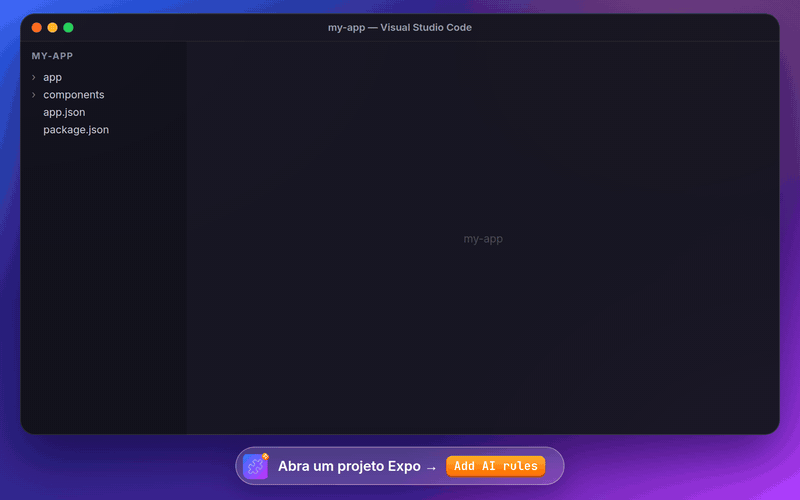
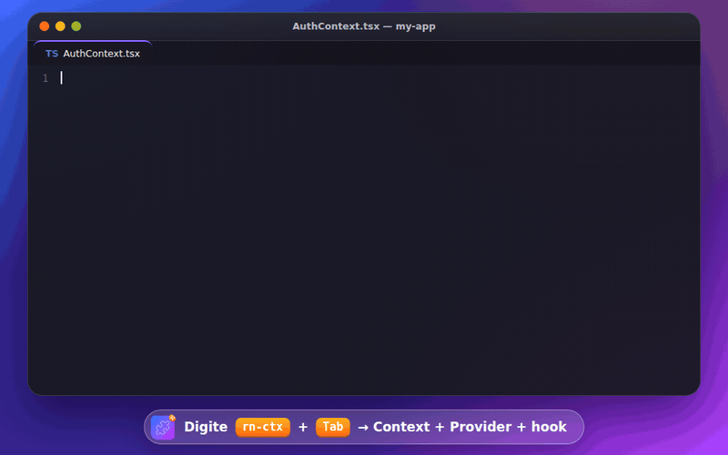
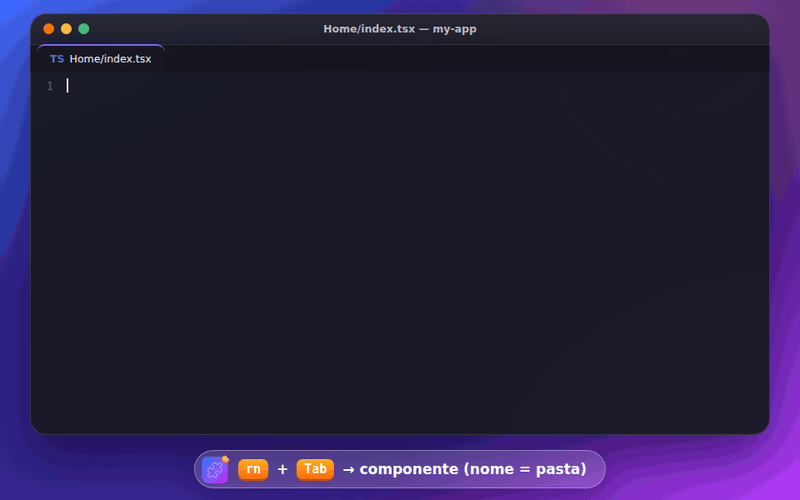
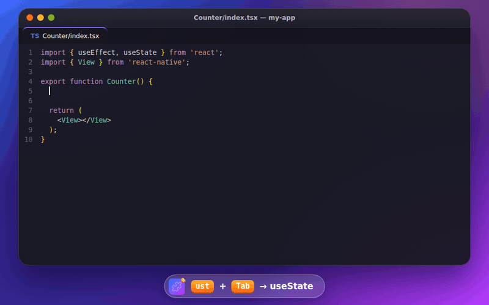

<!--
*** Thank you to see this README.
*** If you have a suggestion that can improve it,
*** fork and create a Pull Request or open an Issue with a "suggestion" tag.
*** Thank you a lot!
-->

<h1 align="center">
  
</h1>

<p align="center">
  <a href="https://marketplace.visualstudio.com/items?itemName=fabianocs.rn-shortcut"></a>
  <a href="https://marketplace.visualstudio.com/items?itemName=fabianocs.rn-shortcut"></a>
  <a href="https://open-vsx.org/extension/fabianocs/rn-shortcut"></a>
  <a href="https://open-vsx.org/extension/fabianocs/rn-shortcut"></a>
</p>

</br>

### ✨ New in 1.3: your AI follows the same templates

Copilot, Cursor and Claude Code generate React Native code in the same shape as your snippets. Open a React Native or Expo project and click **Add AI rules**. Copilot fetches the templates by itself, with no setup. [How it works ↓](#use-with-ai-cursor-copilot-claude-code)

<p align="center">
  
</p>

### Snippets in action

<p align="center">
  
</p>

<p align="center">
  
</p>

<p align="center">
  
</p>

</br>

## About

Snippets for **React Native** and **Expo** projects: components, StyleSheet, styled-components, hooks, `FlatList` and Context — in JavaScript and TypeScript.

Works in **VS Code**, **Cursor**, **Windsurf** and **VSCodium** (via [Open VSX](https://open-vsx.org/extension/fabianocs/rn-shortcut)).

### Supported languages

- JavaScript (`.js`)
- JavaScript React (`.jsx`)
- TypeScript (`.ts`)
- TypeScript React (`.tsx`)

---

## Getting started

Install **React Native Snippets** from the VS Code Marketplace, open any `.js`, `.jsx`, `.ts` or `.tsx` file in VS Code, type a snippet prefix and press `Tab`.

Example: type `rn` and press `Tab` to create a basic React Native component.

---

## Snippets

List of available snippets. **⇥** means the `TAB` key.

|       Snippet | Content                                                    |
| ------------: | ---------------------------------------------------------- |
|        `rn →` | Create a **React Native Component**                        |
|      `rn-s →` | Create a **React Native Component** with inline StyleSheet |
|     `rn-si →` | Create a **React Native Component** importing `./styles`   |
|     `rn-sc →` | Create a **React Native Component** with Styled Components |
|  `rn-style →` | Create a **StyleSheet** file (`styles.ts`)                 |
| `rn-styled →` | Create a **Styled Components** file (`styles.ts`)          |
|  `rn-props →` | Create a **React Native Component** with typed `Props`     |
|     `rn-fl →` | Create a **FlatList** with `keyExtractor` and `renderItem` |
|    `rn-ctx →` | Create a **Context** with Provider and `useXxx()` hook     |

---

## Shortcuts

|      Snippet | Content                               |
| -----------: | ------------------------------------- |
|      `ust →` | Create a new **useState**             |
|      `uef →` | Create a new **useEffect**            |
|       `od →` | Create a new **Object Destructuring** |
|       `fn →` | Create a new **Function**             |
| `fn-async →` | Create a new **Async Function**       |
|       `cl →` | Create a new **Console Log**          |

---

## Use with AI (Cursor, Copilot, Claude Code…)

AI assistants don't trigger snippets, but they do read instruction files in your project. This extension can write those files for you, with the same templates as the snippets, so AI-generated code follows the same patterns.

**From the editor:** when you open a React Native or Expo project, the extension offers to add them (one click). You can also open the Command Palette (`Cmd/Ctrl+Shift+P`) and run **React Native Snippets: Add AI rules to project**. Pick your tools and the files are created, or updated in place if they already exist (your own content is kept). **React Native Snippets: Get Started** opens a short walkthrough.

The files are meant to be **committed**, so your team and cloud agents (Copilot coding agent, Codex, Claude Code on the web) get the same rules. Prefer to keep them to yourself? Choose **Keep on this machine only**: the files the extension created are hidden through `.git/info/exclude`, which is local and never committed. Files that already existed, like your own `AGENTS.md`, are never hidden.

**By hand:** copy the file for your tool from [`ai-rules/`](ai-rules):

| Tool | Copy this file | To |
| --- | --- | --- |
| Cursor | [`ai-rules/react-native-snippets.mdc`](ai-rules/react-native-snippets.mdc) | `.cursor/rules/react-native-snippets.mdc` |
| GitHub Copilot | [`ai-rules/copilot-instructions.md`](ai-rules/copilot-instructions.md) | `.github/copilot-instructions.md` |
| Claude Code | [`ai-rules/CLAUDE.md`](ai-rules/CLAUDE.md) | `CLAUDE.md` |
| Codex and other agents | [`ai-rules/AGENTS.md`](ai-rules/AGENTS.md) | `AGENTS.md` |

If the target file already exists, paste the content at the end of it.

### AI asks the extension for the templates

Assistants can fetch a template filled in with their own names (e.g. `rn-ctx` with `Auth`/`user`) through two tools, `list_snippets` and `get_snippet`.

- **VS Code + Copilot:** nothing to set up. The extension adds the tools to Copilot directly, so **React Native Snippets** shows up **enabled** in Copilot's tool list (agent mode). You can also mention them in a prompt with `#rnSnippet` / `#rnSnippets`. The first time Copilot uses them it may ask for permission; pick **Always Allow** in the menu next to **Allow** to stop the prompt. The model decides when to call a tool; to get the exact template every time, name it in your prompt, e.g. *"Use #rnSnippet rn-ctx to create an auth context"*.
- **Cursor, Claude Code and other MCP clients:** the extension also ships an [MCP](https://modelcontextprotocol.io) server with the same tools (Node.js 18+). Run **React Native Snippets: Copy MCP setup** from the Command Palette, or use:
- **Claude Code:**
  ```bash
  claude mcp add rn-snippets -- npx -y github:fabianocsouza/rn-shortcut
  ```
- **Cursor** (`.cursor/mcp.json`) and other MCP clients:
  ```json
  {
    "mcpServers": {
      "rn-snippets": { "command": "npx", "args": ["-y", "github:fabianocsouza/rn-shortcut"] }
    }
  }
  ```

---

## Contribution

To work on the extension locally (requires Node.js 22+):

```bash
npm install
npm test               # unit tests
npm run package        # generates the .vsix file
npm run publish        # VS Code Marketplace
npm run publish:ovsx   # Open VSX (Cursor, Windsurf, VSCodium)
```

Press `F5` in VS Code to open a window with the extension loaded.

After changing a snippet, run `npm run build:ai-rules` to regenerate `ai-rules/` (CI checks it).

Releases are automatic: bump `version` in `package.json` (and the CHANGELOG), merge to `main`, and the **Release** workflow publishes to the VS Code Marketplace and Open VSX and creates a GitHub release.


Any contribution you make will be **much appreciated**.

#### Find me elsewhere

[](https://www.linkedin.com/in/fabianocsouza/)
[](https://github.com/fabianocsouza)

</br>

[](LICENSE)

This project is derived from [rocketseat-vscode-react-native-snippets](https://github.com/Rocketseat/rocketseat-vscode-react-native-snippets), originally created by **Claudio Junior** and published by **Rocketseat** under the MIT license.

Modified by Fabiano C. Souza in 2025 and redistributed under the terms of the MIT license.

See the `LICENSE` file for more details.
